<div align="center">

<a href="https://preflight-lemon.vercel.app">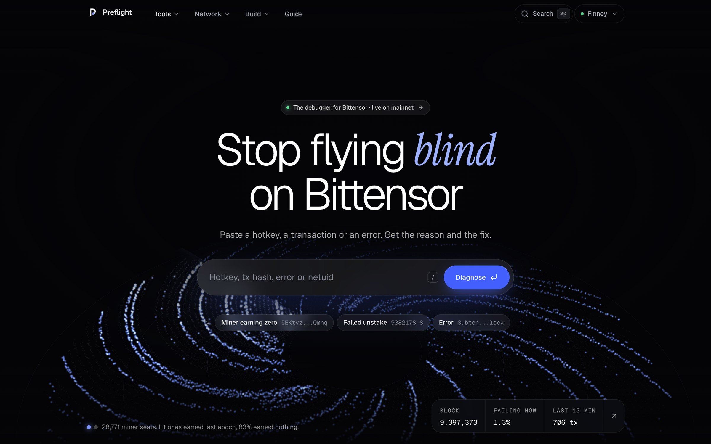</a>

<h1>Preflight</h1>

<p><strong>Stop flying blind on Bittensor.</strong><br>
Preflight is the debugger for Bittensor. Paste a hotkey, a transaction or an error,<br>
and it tells you why it failed, what the next epoch will pay, and what would break before you sign.</p>

<p>
<a href="https://preflight-lemon.vercel.app"></a>
<a href="https://github.com/Adwaitbytes/preflight/actions/workflows/ci.yml"></a>
<a href="LICENSE"></a>


<a href="#use-it-from-your-own-claude"></a>
<a href="https://t.me/PreflightAlertsbot"></a>
</p>

<p>
<a href="https://preflight-lemon.vercel.app"><b>Open the app</b></a>
&nbsp;·&nbsp;
<a href="https://drive.google.com/file/d/1h2e8JKmDZNxMYGIeYhRd8QaqjNFUZslB/view"><b>▶ Watch the 3 minute film</b></a>
&nbsp;·&nbsp;
<a href="#quick-start">Quick start</a>
&nbsp;·&nbsp;
<a href="#how-it-works">How it works</a>
&nbsp;·&nbsp;
<a href="https://preflight-lemon.vercel.app/v1/docs">API</a>
&nbsp;·&nbsp;
<a href="docs/llms.txt">llms.txt</a>
</p>

</div>

<br>

## What Preflight does

Three jobs, from one paste, every answer read from mainnet at a single block.

<p align="center"><a href="https://preflight-lemon.vercel.app">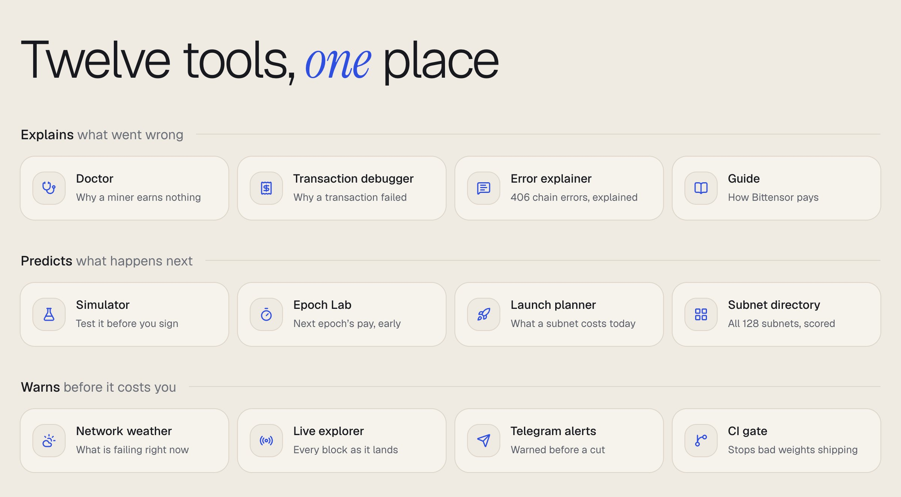</a></p>

| | When | Tools |
|---|---|---|
| **Explains** | Something already went wrong. You get the cause in plain words and the fix | **Doctor**: why a miner or validator earns nothing, 27 rules<br>**Transaction debugger**: why a transaction failed and what it cost you<br>**Explain an error**: any of 406 chain errors in plain words |
| **Predicts** | You are about to act. You see what happens before you pay for it | **Epoch Lab**: the next epoch's pay before the chain runs it, plus what-ifs<br>**Simulator**: will this transaction work, checked before you sign<br>**Launch planner**: what a new subnet costs today, and what it replaces |
| **Warns** | You are not looking. Preflight tells you before it costs TAO | **Network weather**: what is failing on chain right now<br>**Telegram alerts**: a message before an epoch cuts your pay<br>**CI gate**: stops weights consensus would cut, before they ship |

It only reads. It never asks for keys, never signs and never sends anything, and the simulator never broadcasts.

<br>

## Why it exists

Bittensor tells you what happened. It rarely tells you why, and it never tells you before.

**Miners earn zero and never learn why.** On 30 October 2026 we read every miner seat on Bittensor at block 9,391,986. **23,737 of 28,771 seats earned nothing** at the last epoch. That is 83%. The chain shows each of them a zero and no reason, so miners guess: they restart, re-register and rewrite code that was never the problem, and burn TAO doing it.

**Transactions fail and still charge you.** In a two hour sample of mainnet (600 blocks), **103 of 9,224 transactions failed**, about 1 in 90, and every one still paid its fee. What comes back is a bare code like `SubtensorModule.InsufficientLiquidity`.

**You find out after it costs you.** The epoch pays, the registration burns, the weights get set, and only then can you see it went wrong.

Explorers like Taostats show the same numbers, and they are great at it. Preflight turns the numbers into reasons, and gets the answer to you before the chain does.

<details>
<summary><b>What the Doctor found when it checked all 23,737 zero seats</b></summary>
<br>

<p align="center">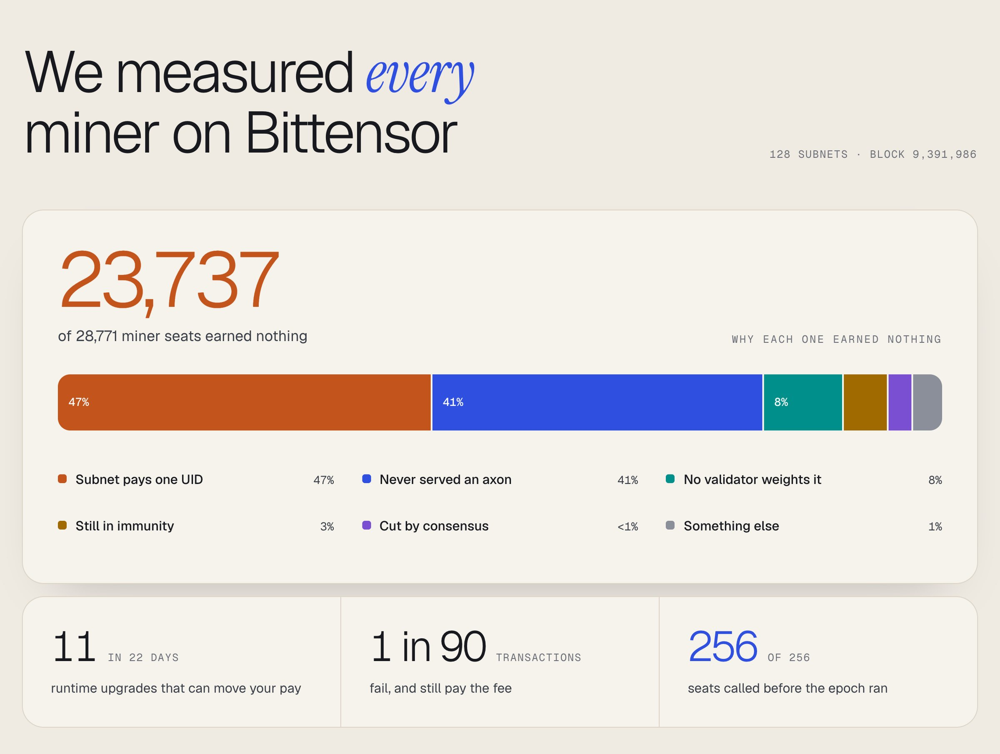</p>

| Why it earned nothing | Seats | Share |
|---|---:|---:|
| The subnet pays 90% or more of miner pay to one UID (an owner burn or one winner) | 11,139 | 47% |
| It never served an axon, so validators have nothing to query | 9,782 | 41% |
| No voting validator puts any weight on it | 1,807 | 8% |
| It registered recently and is still in immunity | 706 | 3% |
| Validators weight it, but consensus cuts it to zero | 59 | under 1% |
| Something else (the Doctor names the rule for each one) | 244 | 1% |

</details>

<br>

## See it work

Paste a hotkey and the Doctor answers in one sentence, with the fix and the evidence behind it, read from mainnet at a single block.

<p align="center">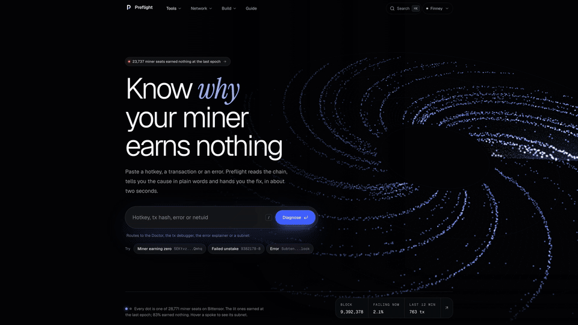</p>

<p align="center">
<a href="https://drive.google.com/file/d/1h2e8JKmDZNxMYGIeYhRd8QaqjNFUZslB/view">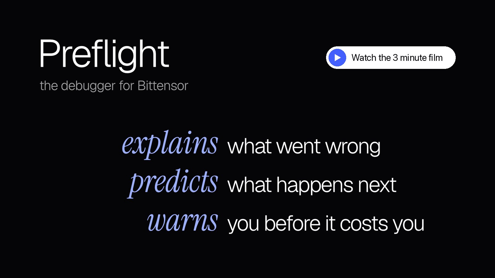</a><br>
<sub>▶ <a href="https://drive.google.com/file/d/1h2e8JKmDZNxMYGIeYhRd8QaqjNFUZslB/view">Watch the film</a>: the whole product in 3 minutes, every screen real and on mainnet.</sub>
</p>

<br>

## Quick start

You do not need to install anything to try it. Pick the place you already work.

| Where | How |
|---|---|
| **Browser** | Open [preflight-lemon.vercel.app](https://preflight-lemon.vercel.app) and paste a hotkey, a transaction or an error |
| **Terminal, no install** | `uvx --from git+https://github.com/Adwaitbytes/preflight preflight doctor <hotkey> --netuid 64` |
| **Terminal, installed** | `uv tool install git+https://github.com/Adwaitbytes/preflight` then `preflight doctor <hotkey>` |
| **Your own Claude** | `claude mcp add preflight -- uvx --from git+https://github.com/Adwaitbytes/preflight preflight mcp` |
| **Telegram** | Message [@PreflightAlertsbot](https://t.me/PreflightAlertsbot) with `/doctor <hotkey>`, or just paste it |
| **Any language** | `curl https://preflight-lemon.vercel.app/v1/doctor/finney/<hotkey>?netuid=64` |
| **CI** | `uses: Adwaitbytes/preflight@main` (see [CI](#ci-stop-a-broken-neuron-before-it-ships)) |

Try it on a real broken miner right now:

```bash
uvx --from git+https://github.com/Adwaitbytes/preflight preflight doctor \
  5EKtvzbEvYZPRJdo42ug7mWrHdt4AurCNMs5CAefuBHfQmhq --netuid 64
```

```text
 BROKEN   UID 0 on SN64 earns nothing because no validator has scored it
finney at block 9,395,595, runtime 486  3,306 ms  

╭─  SN64 Chutes  ──────────────────────────────────────────────────────────────────────────╮
│ UID 0  miner  stake 0.40  incentive 0.0000  trust 0.000  emission 0.0000  axon none      │
│                                                                                          │
│  CRITICAL PF108 No validator has scored this UID                                         │
│   Incentive only comes from validators putting weight on a UID. None of the permitted    │
│ validators' latest weights include this one, so it earns nothing until they do           │
│   Validators weighting this UID  0 of 17                                                 │
│   UID 1 (5DU1dv...S7ww)          stake 1,384,943 alpha, last  SubtensorModule.LastUpdate │
│                                  set weights 284 blocks                                  │
│                                  (about 57 min) ago                                      │
│   Read at block                  9,395,595                                               │
│ ╭─ Next step ──────────────────────────────────────────────────────────────────────────╮ │
│ │ Check that the axon is reachable and that the miner answers the subnet's queries in  │ │
│ │ the format validators expect                                                         │ │
│ ╰──────────────────────────────────────────────────────────────────────────────────────╯ │
│   https://www.bittensor.com/docs/guides/mining                                           │
│                                                                                          │
╰─────────────────────────────────────────────────────────────────────────────── 19 rules ─╯
```

Then the rest of the debugger, once installed:

```bash
preflight tx 9382178-8      # why a real unstake failed, and the fee it still paid
preflight epoch 64          # what SN64's next epoch will pay, before the chain runs it
preflight sim burned_register --netuid 64 --as <coldkey> --hotkey <hotkey>   # will it work?
preflight weather           # is it me, or the whole network?
```

<br>

## What it answers

Every tool starts from a question miners and validators actually ask, at the moment they ask it.

### Before you act

| You ask | Tool | Try |
|---|---|---|
| Will this transaction work if I send it now? | **Simulator**: the runtime's own checks against live state, or the real runtime on a fork. Never broadcasts | `preflight sim burned_register --netuid 64 --as <coldkey> --hotkey <hotkey>` |
| What will the next epoch pay me? | **Epoch Lab**: Bittensor's own consensus math on live data, before the chain runs it | `preflight epoch 64 --hotkey <ss58>` |
| What if kappa changed, or a validator went offline? | **Epoch Lab what-ifs**: recompute the same epoch with your changes | `preflight epoch 64 --kappa 0.3 --drop 252` |
| Should I mine this subnet? | **Mine**: what earning miners make, what it takes to keep a seat, payback | `preflight mine 51` |
| What does launching a subnet cost today? | **Launch planner**: lock cost, rate limit, the subnet it would replace, the timeline | `preflight plan` |
| What is this subnet, and is it healthy? | **Subnets**: a 0 to 100 health score and every hyperparameter explained | `preflight subnet 64` |

### When it breaks

| You ask | Tool | Try |
|---|---|---|
| Why does my miner earn nothing? | **Doctor**: 27 rules for miners, validators and subnets, each citing what it read | `preflight doctor <hotkey>` |
| Why did my transaction fail? | **Transaction debugger**: the error in plain words, with that transaction's own numbers | `preflight tx 9382178-8` |
| What does this error mean? | **Explain an error**: 406 chain errors plus the traps the catalog misses | `preflight tx "SubtensorModule.InsufficientLiquidity"` |
| Why did my incentive drop? | **Why**: names the validators whose support moved it, and what each did | `preflight why <hotkey> --netuid 19` |
| Which of my seats are broken? | **Fleet**: every hotkey a coldkey owns, on every subnet, worst first | `preflight fleet <coldkey>` |

### Always watching

| You ask | Tool | Try |
|---|---|---|
| Is it me, or the whole network? | **Network weather**: what is failing on chain right now, grouped by error | `preflight weather` |
| What is happening on chain right now? | **Live explorer**: every extrinsic as a plain sentence, as blocks land | `preflight live --failures` |
| Tell me before it breaks | **Watch**: Telegram alerts when a neuron breaks, or before an epoch cuts its pay | `preflight watch add <hotkey> --netuid 64` |
| Will consensus keep my new weights? | **CI gate**: exits 1 if consensus would cut them, before they are ever set | `preflight epoch 64 --weights new.json --validator 12 --min-trust 0.9` |

<br>

## A tour of the real screens

### Before you act

<table>
<tr>
<td width="50%" valign="top">
<a href="https://preflight-lemon.vercel.app/sim">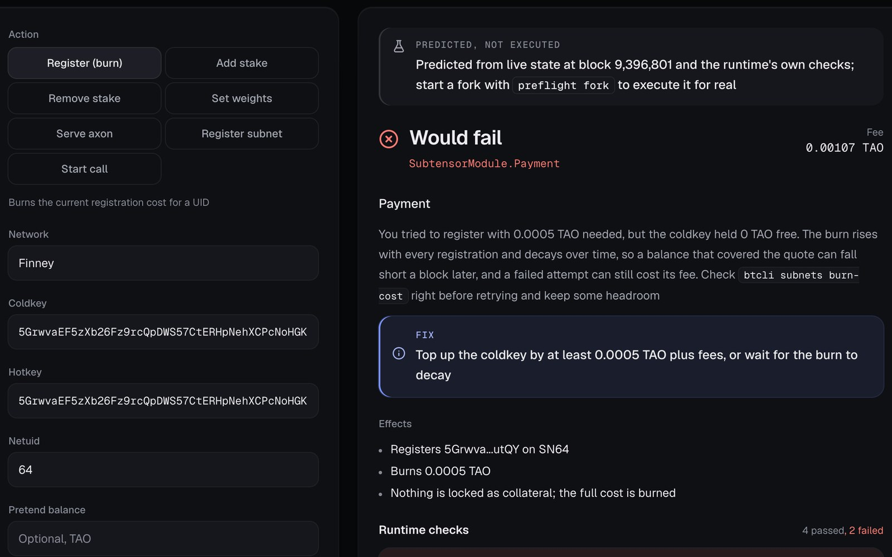</a>
<p><b>Simulator.</b> A registration from a coldkey with no TAO, tried before anyone signs: <code>Would fail · SubtensorModule.Payment</code>, why, and exactly how much to top up. Nothing is sent.</p>
</td>
<td width="50%" valign="top">
<a href="https://preflight-lemon.vercel.app/epoch/finney/64">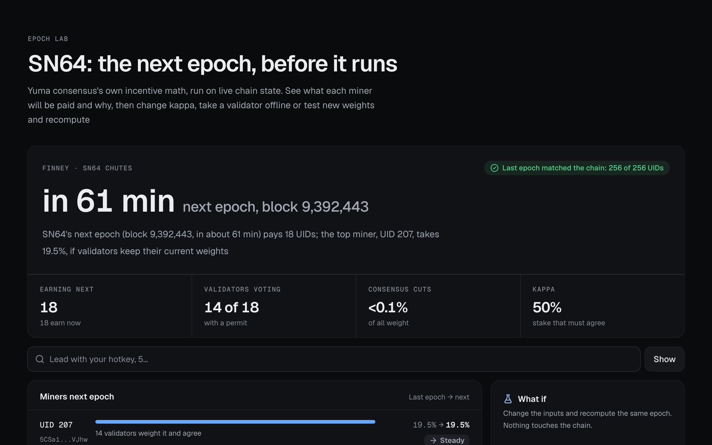</a>
<p><b>Epoch Lab.</b> The next epoch counts down to its real block. Each miner's pay next epoch and why. The green badge says the last real epoch matched the chain on every UID.</p>
</td>
</tr>
</table>

### When it breaks

<table>
<tr>
<td width="50%" valign="top">
<a href="https://preflight-lemon.vercel.app/doctor/finney/5EKtvzbEvYZPRJdo42ug7mWrHdt4AurCNMs5CAefuBHfQmhq?netuid=64">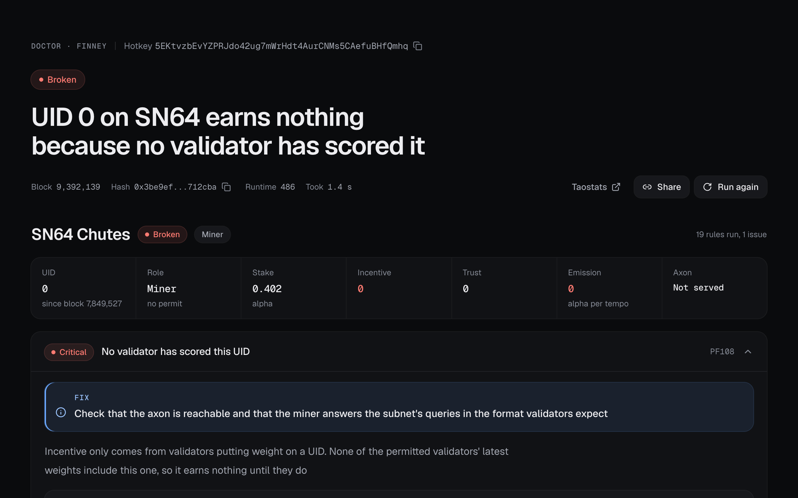</a>
<p><b>Doctor.</b> The verdict in one sentence, the fix, and the evidence table with the storage item behind each value. Every answer names its block, hash and runtime.</p>
</td>
<td width="50%" valign="top">
<a href="https://preflight-lemon.vercel.app/tx/finney/9382178-8">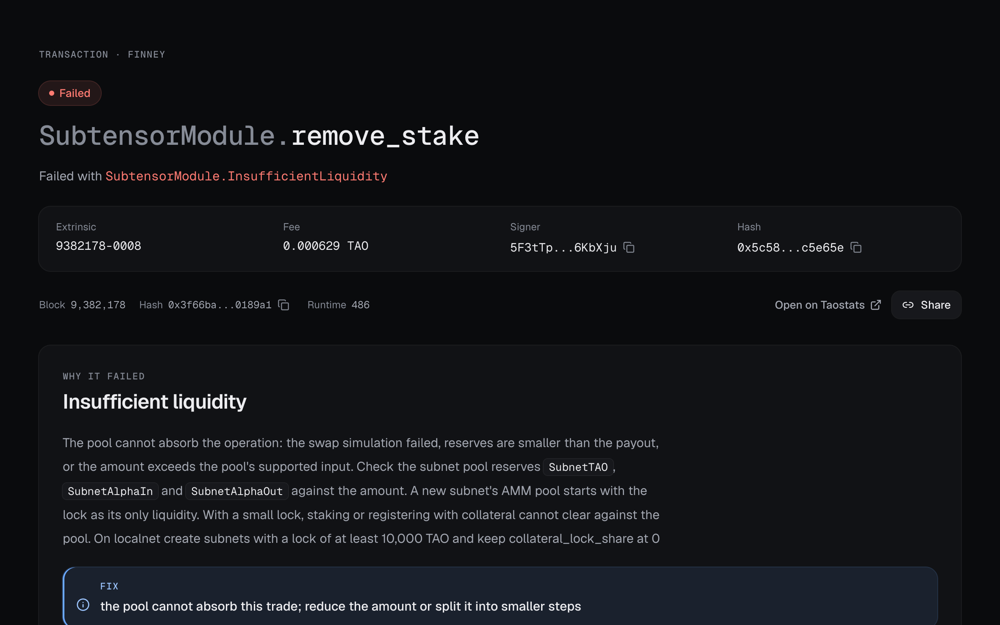</a>
<p><b>Transaction debugger.</b> A failed <code>remove_stake</code>: what <code>InsufficientLiquidity</code> means here, the fee it still paid, and what to do instead.</p>
</td>
</tr>
</table>

### Always watching

<table>
<tr>
<td width="50%" valign="top">
<a href="https://preflight-lemon.vercel.app/weather">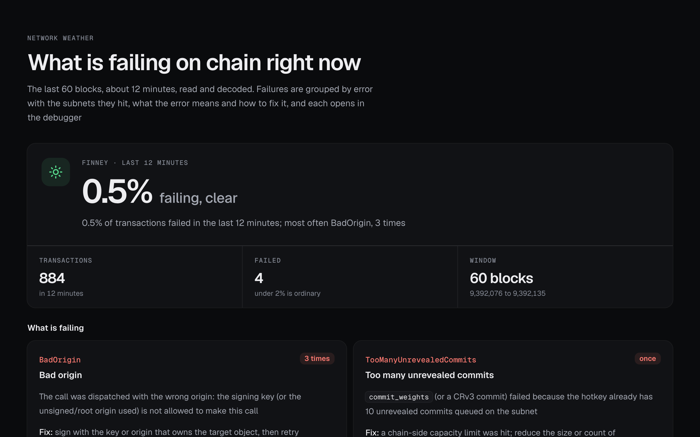</a>
<p><b>Network weather.</b> The share of transactions failing right now, grouped by error, with the subnets each one hits and a link to open any of them.</p>
</td>
<td width="50%" valign="top">
<p><b>Telegram alerts.</b> Add a watch and <a href="https://t.me/PreflightAlertsbot">@PreflightAlertsbot</a> messages you before the next epoch cuts your pay. This one went out 22 minutes early, and the chain did exactly what it said:</p>
<pre>Preflight: UID 85 on SN19 is set to drop to zero
at the next epoch, block 9,392,129 (in about 0.4 h)</pre>
<p><b>CI gate.</b> The GitHub Action boots a localnet subnet and fails the job on findings, and <code>preflight epoch --min-trust</code> stops weights consensus would cut before they are ever set.</p>
</td>
</tr>
</table>

Also on the site: [Explain an error](https://preflight-lemon.vercel.app/explain), the [Live explorer](https://preflight-lemon.vercel.app/live), the [Subnet directory](https://preflight-lemon.vercel.app/subnets), the [Launch planner](https://preflight-lemon.vercel.app/plan) and a [Guide](https://preflight-lemon.vercel.app/guide) that explains Bittensor from zero.

<br>

## How it works

One engine, many surfaces. Every tool is a Python function in `src/preflight/core`, and the same function answers the website, the CLI, the HTTP API, Claude, the Telegram bot and CI. They all speak the models in `src/preflight/core/models.py`, which also generate the website's TypeScript types, so the answers can never drift apart.

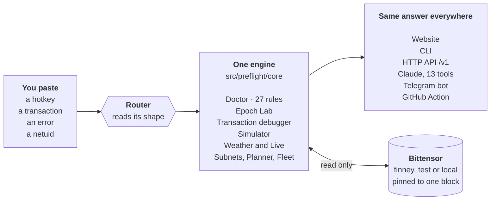

### One block per answer

The chain moves every 12 seconds. If a diagnosis read stake at one block and weights at the next, it could contradict itself. So every answer first **pins one block** (the head's parent, whose hash is a cheap read), then makes all its reads at that block concurrently. The report carries the block number, block hash and runtime spec it was read at, so anyone can check it.

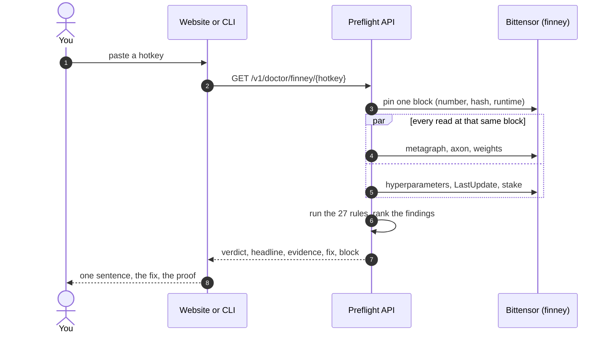

<br>

## Epoch Lab: the math, and the proof

Epoch Lab is a port of the incentive half of Yuma consensus, the math the chain runs every epoch to decide who gets paid. It follows `run_epoch.rs` step by step, on live state, in about two seconds, with no fork and no download.

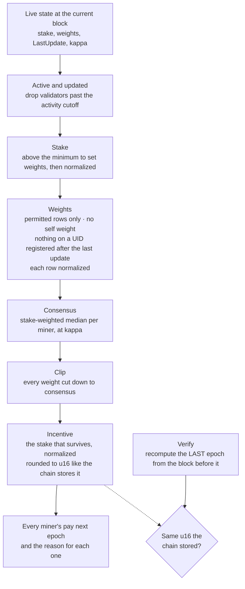

Every read also recomputes the last real epoch and compares each UID with the `Incentive` the chain stored. If they ever disagree, the page says so.

### Does it hold up?

We wrote down subnet 19's next epoch at block 9,392,018, **111 blocks (about 22 minutes) before it ran**, then let the chain run it.

<p align="center">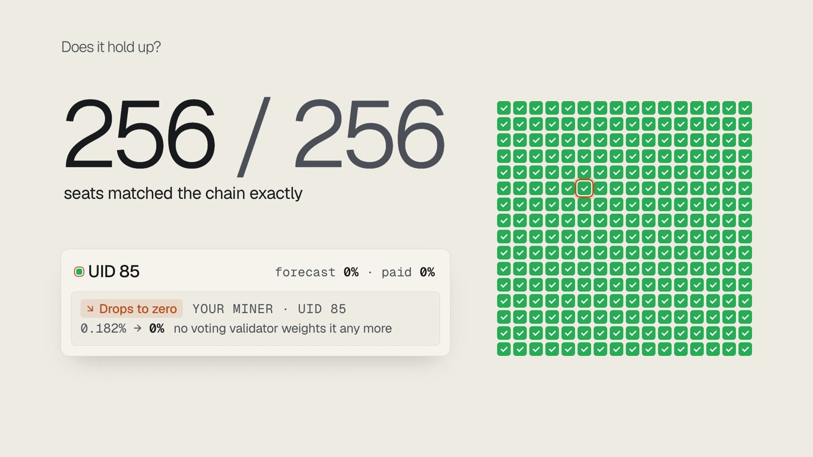</p>

| Check | Result |
|---|---|
| SN19 forecast, 111 blocks before the epoch | **256 of 256** seats exact, including UID 85, which we said would drop to zero, and did |
| SN19, miners paid | 28 forecast, 28 paid |
| SN64 forecast, 90 blocks before the epoch | 243 of 256 |
| Last epoch rebuilt: SN1, SN3, SN8, SN9, SN19, SN56, SN64 | **256 of 256** on every one |
| Last epoch rebuilt: SN4 | 254 of 256 (largest gap: 2 units out of 65,535) |
| Last epoch rebuilt: SN51 | 245 of 256 (0.25% total difference, still being chased) |

The method and every measurement: [docs/decisions/007-epoch-lab.md](docs/decisions/007-epoch-lab.md).

<br>

## The transaction debugger

Paste anything that names a transaction. Preflight works out what it is, finds it, and explains it with the chain state from the block **before** it ran, which is the state the runtime actually checked it against.

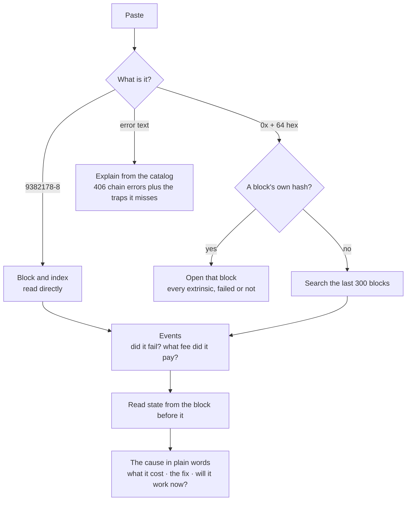

<details>
<summary><b>Real output:</b> a failed unstake on mainnet</summary>

```text
$ preflight tx 9382178-8
 FAILED   SubtensorModule.remove_stake  block 9,382,178 index 8
0x5c5826911f81c995d7b0f7e9e419a3b09e2fbcf1a638e60711e55b5c6bc5e65e
╭─ Call ───────────────────────────────────────────────────────────────────────────────────╮
│  signer           5F3tTpzFuQ8yy91hNcB8BaEbgX1oLBPCZE5L6WvRjq6KbXju                       │
│  hotkey           5DU1dvXbvjVRs5omKrbZzLNB6ZL9uNnzQrS1H8MFcSdFS7ww                       │
│  netuid           SN64                                                                   │
│  amount_unstaked  0.000000001 alpha                                                      │
│  fee              0.000629364 TAO                                                        │
╰──────────────────────────────────────────────────────────────────────────────────────────╯
╭─ Events ─────────────────────────────────────────────────────────────────────────────────╮
│  0  Balances.Withdraw                      who=5F3tTp...bXju, amount=629364              │
│  1  Balances.Deposit                       who=5F3tTp...bXju, amount=0                   │
│  2  TransactionPayment.TransactionFeePaid  Fee paid 0.000629364 TAO                      │
│  3  System.ExtrinsicFailed                 Failed with                                   │
│                                            SubtensorModule.InsufficientLiquidity         │
╰──────────────────────────────────────────────────────────────────────────────────────────╯
╭─  SubtensorModule.InsufficientLiquidity: Insufficient liquidity  ────────────────────────╮
│ The pool cannot absorb the operation: the swap simulation failed, reserves are smaller   │
│ than the payout, or the amount exceeds the pool's supported input. Check the subnet pool │
│ reserves `SubnetTAO`, `SubnetAlphaIn` and `SubnetAlphaOut` against the amount.           │
│                                                                                          │
│ A new subnet's AMM pool starts with the lock as its only liquidity. With a small lock,   │
│ staking or registering with collateral cannot clear against the pool. On localnet create │
│ subnets with a lock of at least 10,000 TAO and keep collateral_lock_share at 0           │
│ ╭─ Next step ──────────────────────────────────────────────────────────────────────────╮ │
│ │ the pool cannot absorb this trade; reduce the amount or split it into smaller steps  │ │
│ ╰──────────────────────────────────────────────────────────────────────────────────────╯ │
│ code insufficient_liquidity trap reserves_too_low                                        │
│ https://www.bittensor.com/code/pallets/subtensor/src/macros/errors.rs#L192               │
│ https://www.bittensor.com/docs/errors/chain/InsufficientLiquidity                        │
╰──────────────────────────────────────────────────────────────────────────────────────────╯
```

</details>

<details>
<summary><b>Real output:</b> what is failing on chain right now</summary>

```text
$ preflight weather
 STORMY   2.1% of transactions failed in the last 12 minutes; most often BadOrigin, 12 times
finney at block 9,395,596, runtime 486  blocks 9,395,537 to 9,395,596, 698 transactions, 15 
failed
╭─ What is failing ────────────────────────────────────────────────────────────────────────╮
│  Error                   Times  Subnets  What it means           Open one                │
│  BadOrigin                  12           The call was            preflight tx            │
│                                          dispatched with the     9395537-18              │
│                                          wrong origin: the                               │
│                                          signing key (or the                             │
│                                          unsigned/root origin                            │
│                                          used) is not allowed                            │
│                                          to make this call                               │
│  SlippageTooHigh             1  SN103    A stake, unstake, or    preflight tx            │
│                                          move would move the     9395563-13              │
│                                          price past the                                  │
│                                          slippage-protection                             │
│                                          limit (default 5%                               │
│                                          tolerance)                                      │
│  NotEnoughBalanceToSta…      1  SN88     The coldkey's free      preflight tx 9395572-8  │
│                                          balance is less than                            │
│                                          the TAO required,                               │
│                                          either the stake                                │
│                                          amount in add_stake or                          │
│                                          the burn cost of a                              │
│                                          registration                                    │
│  AmountTooLow                1  SN51     A stake, unstake, move  preflight tx            │
│                                          or swap amount was      9395588-11              │
│                                          zero or its TAO                                 │
│                                          equivalent fell below                           │
│                                          the minimum stake                               │
│                                          threshold after fees                            │
│                                          and slippage                                    │
╰──────────────────────────────────────────────────────────────────────────────────────────╯
  Activity: 142 weights, 131 evm, 124 commitment, 104 shielded, 77 stake, 44 unstake, 44 
transfer, 17 other, 10 serve, 5 register
  Busiest subnets: SN107 (95), SN53 (28), SN105 (23), SN123 (16), SN62 (15), SN88 (9)
```

</details>

<details>
<summary><b>Real output:</b> the next epoch, checked against the last one (rows cut short)</summary>

```text
$ preflight epoch 64 --verify
 NEXT EPOCH   SN64's next epoch (block 9,395,683, in about 12 min) pays 19 UIDs; the top miner, UID 
177, takes 19.2%, if validators keep their current weights
finney at block 9,395,625, runtime 486  epoch at block 9,395,683, kappa 50%
  ✓ Matched the chain: all 256 UIDs at SN64's last epoch (block 9,395,323) to the last step the 
chain stores
╭─ Miners, 19 earning next epoch ──────────────────────────────────────────────────────────────────╮
│  UID         Now    Next  Change  Cut by consensus  Why                                          │
│  UID 177  0.1906  0.1924     +1%                0%  14 validators weight it and agree            │
│  UID 207  0.1906  0.1909     +0%                0%  14 validators weight it and agree            │
│  UID 194  0.1027  0.1033     +1%                0%  14 validators weight it and agree            │
│  UID 254  0.0762  0.0764     +0%                0%  14 validators weight it and agree            │
│  UID 82   0.0757  0.0755     -0%                0%  14 validators weight it and agree            │
│  UID 14   0.0638  0.0641     +0%                0%  14 validators weight it and agree            │
│  UID 145  0.0611  0.0612     +0%                0%  14 validators weight it and agree            │
│  UID 8    0.0602  0.0601     -0%                0%  14 validators weight it and agree            │
│  UID 52   0.0490  0.0492     +0%                0%  14 validators weight it and agree            │
│  UID 86   0.0294  0.0282     -4%                2%  14 validators weight it; consensus cuts      │
│                                                     1.57%, since validators holding kappa        │
│                                                     (50.0%) of stake gave less                   │
│  UID 21   0.0267  0.0236    -11%                6%  14 validators weight it; consensus cuts      │
│                                                     6.33%, since validators holding kappa        │
│                                                     (50.0%) of stake gave less                   │
│  …                                                                                               │
╰──────────────────────────────────────────────────────────────────────────────────────────────────╯
```

</details>

<br>

## The simulator: try it before you pay

Pick an action (register, stake, unstake, set weights, serve an axon, register a subnet or start a call) and Preflight tries it against live state before you sign anything. With a fork running (`preflight fork`), the call runs on the chain's own runtime against a copy of mainnet. Without one, it is predicted from the runtime's own checks, and the result says which. Nothing is ever broadcast.

The SDK's own dry run said `ok` for a zero balance registration, a miner setting weights and a stranger calling `start_call`. All three fail on chain, and the simulator reports the exact error ([decision 001](docs/decisions/001-simulator.md)).

<details>
<summary><b>Real output:</b> a registration that would fail, caught before it cost a fee</summary>

```text
$ preflight sim burned_register --netuid 64 --as 5Grwva...utQY --hotkey 5Grwva...utQY
 WOULD FAIL   burned_register  as 5GrwvaEF5zXb26Fz9rcQpDWS57CtERHpNehXCPcNoHGKutQY
Predicted from live state at block 9,396,914 and the runtime's own checks; start a fork with 
`preflight fork` to execute it for real
╭──────────────────────────────────────────────────────────────────────────────────────────────╮
│  coldkey                        5GrwvaEF5zXb26Fz9rcQpDWS57CtERHpNehXCPcNoHGKutQY             │
│  hotkey                         5GrwvaEF5zXb26Fz9rcQpDWS57CtERHpNehXCPcNoHGKutQY             │
│  netuid                         SN64                                                         │
│  fee                            0.001070890 TAO                                              │
│  effect                         Registers 5Grwva...utQY on SN64                              │
│  effect                         Burns 0.0005 TAO                                             │
│  effect                         Nothing is locked as collateral; the full cost is burned     │
│  Balance covers the fee         fail: 0.000000 TAO free for a 0.001071 fee                   │
│  Registration open              pass: NetworkRegistrationAllowed is True                     │
│  Per block cap                  pass: 0 of 1 used this block                                 │
│  Per interval cap               pass: 0 of 3 used this interval                              │
│  Hotkey not already registered  pass: no UID yet                                             │
│  Balance covers burn and fee    fail: 0.0000 TAO free, needs 0.0005 burn + 0.001071 fee      │
│  time                           3,550 ms                                                     │
╰──────────────────────────────────────────────────────────────────────────────────────────────╯
╭─  SubtensorModule.Payment: Payment  ─────────────────────────────────────────────────────────╮
│ You tried to register with 0.0005 TAO needed, but the coldkey held 0.0000 TAO free.          │
│                                                                                              │
│ The burn rises with every registration and decays over time, so a balance that covered the   │
│ quote can fall short a block later, and a failed attempt can still cost its fee. Check       │
│ `btcli subnets burn-cost` right before retrying and keep some headroom                       │
│ ╭─ Next step ──────────────────────────────────────────────────────────────────────────────╮ │
│ │ Top up the coldkey by at least 0.0005 TAO plus fees, or wait for the burn to decay       │ │
│ ╰──────────────────────────────────────────────────────────────────────────────────────────╯ │
│ code insufficient_balance trap burn_moved                                                    │
╰──────────────────────────────────────────────────────────────────────────────────────────────╯
```

</details>

<br>

## The 27 rules

The Doctor's rules mirror the runtime. Pruning order, immunity, owner immunity, the `set_weights` check sequence and axon address validation are ported from subtensor and cite the file and line they come from.

<details>
<summary><b>Miner rules</b> (13)</summary>

| Code | Finds |
|---|---|
| PF101 | Not registered on the subnet |
| PF102 | Lost its UID, and when |
| PF103 | Still in immunity, and for how long |
| PF104 | What this UID's emission is |
| PF105 | No axon published |
| PF106 | The axon points at an address validators cannot reach (loopback, private) |
| PF107 | The axon did not accept a connection |
| PF108 | No validator has scored this UID |
| PF109 | Only inactive validators are scoring it |
| PF110 | Weighted by validators but clipped to zero by consensus |
| PF111 | Trust well below the subnet median |
| PF112 | Other UIDs on the same coldkey |
| PF113 | The subnet requires a newer weights version |

</details>

<details>
<summary><b>Validator rules</b> (8)</summary>

| Code | Finds |
|---|---|
| PF201 | Has stake but no validator permit |
| PF202 | When it last set weights |
| PF203 | A new `set_weights` would be rejected until a later block |
| PF204 | Stake below the minimum needed to set weights |
| PF205 | Weights committed and waiting to be revealed |
| PF206 | The last weights break the subnet's weight limits |
| PF207 | Share of weight going to its own coldkey |
| PF208 | Weights that look like a copy of last epoch's consensus |

</details>

<details>
<summary><b>Subnet rules</b> (6)</summary>

| Code | Finds |
|---|---|
| PF301 | Whether registration is allowed |
| PF302 | Registration cost far above its recent average |
| PF303 | Emissions have not started |
| PF304 | Incentive going to the owner hotkey's UID |
| PF305 | Stale validators |
| PF306 | The owner coldkey |

</details>

<br>

## Use it from your own Claude

One command gives Claude 13 tools. They return the same models as the API.

```bash
claude mcp add preflight -- uvx --from git+https://github.com/Adwaitbytes/preflight preflight mcp
```

| Tool | Answers |
|---|---|
| `diagnose_neuron` | Why a hotkey earns what it earns |
| `preview_epoch` | The next epoch before it runs, with optional what-ifs |
| `explain_incentive_change` | Why a UID's incentive moved, and which validators moved it |
| `explain_extrinsic` | Why a transaction failed |
| `explain_error` | What an error means, and the fix |
| `simulate` | Would this transaction work now |
| `network_weather` | What is failing on chain right now |
| `recent_activity` | The latest blocks, as sentences |
| `diagnose_fleet` | Every seat a coldkey owns |
| `mining_economics` | What miners on a subnet earn |
| `subnet_health` | A subnet's health score and hyperparameters |
| `launch_plan` | What launching a subnet costs now |
| `find_subnet` | Subnets that do something, with sources |

Agents that read docs instead: [docs/llms.txt](docs/llms.txt) is a plain text map of every endpoint, written for language models.

<br>

## The HTTP API

Free, typed and versioned. Interactive docs at [/v1/docs](https://preflight-lemon.vercel.app/v1/docs).

```bash
curl -s "https://preflight-lemon.vercel.app/v1/doctor/finney/5EKtvzbEvYZPRJdo42ug7mWrHdt4AurCNMs5CAefuBHfQmhq?netuid=64" \
  | jq '{verdict, headline, block: .chain.block}'
```

```json
{
  "verdict": "broken",
  "headline": "UID 0 on SN64 earns nothing because no validator has scored it",
  "block": 9395608
}
```

| Endpoint | Returns |
|---|---|
| `GET /v1/doctor/{network}/{hotkey}` | Verdict, headline, findings with evidence and fixes |
| `GET /v1/epoch/{network}/{netuid}` | The next epoch for every UID, and why |
| `POST /v1/epoch/{network}/{netuid}` | The same epoch with what-ifs: kappa, validators offline, new weights |
| `GET /v1/epoch/{network}/{netuid}/check` | The last epoch recomputed and compared with the chain |
| `GET /v1/tx/{network}/{hash or block-index}` | The decoded transaction, its events, the failure explained |
| `GET /v1/block/{network}/{number or hash}` | Every extrinsic in a block, failed or not |
| `POST /v1/explain-error` | Any error text, explained |
| `POST /v1/sim/{network}` | A transaction tried against live state, never broadcast |
| `GET /v1/weather/{network}` | Failures over the last 60 blocks, grouped by error |
| `GET /v1/live/{network}` | The latest blocks as plain sentences |
| `GET /v1/change/{network}/{hotkey}` | Why a UID's incentive changed |
| `GET /v1/fleet/{network}/{coldkey}` | Every seat a coldkey owns |
| `GET /v1/economics/{network}/{netuid}` | Should I mine here |
| `GET /v1/subnets/{network}` and `/{netuid}` | The directory, health and hyperparameters |
| `GET /v1/plan/{network}` | What launching a subnet costs now |
| `GET /v1/health` | Whether the API and the chain are answering |

Every response carries `chain`: the network, endpoint, block, block hash and runtime spec it was read at.

<br>

## Telegram

[@PreflightAlertsbot](https://t.me/PreflightAlertsbot) answers every tool in a chat, and can watch your miner.

`/doctor` · `/why` · `/epoch` · `/fleet` · `/tx` · `/explain` · `/mine` · `/subnet` · `/weather` · `/live` · `/plan` · `/find` · `/watch` · `/help`

Or just paste a hotkey, a block-index or an error. With `/watch`, it messages you when your neuron is deregistered, stops being scored, loses its permit or its incentive halves, and **before** the next epoch cuts your pay:

```text
Preflight: UID 85 on SN19 is set to drop to zero at the next epoch, block 9,392,129 (in about 0.4 h)
0.00182 now, 0.00000 next if validators keep their current weights: no voting validator weights it any more
```

<br>

## CI: stop a broken neuron before it ships

The GitHub Action boots a fresh localnet subnet, runs the Doctor, and fails the job on findings at or above a severity.

```yaml
- uses: Adwaitbytes/preflight@main
  with:
    fail-on: high          # critical, high, medium or info
    network: local         # or test, finney, or a ws:// endpoint
```

Validators can gate a scoring change on real mainnet consensus before it ever sets weights. This exits 1 if consensus would cut more than 10% of UID 12's weight:

```bash
preflight epoch 64 --weights new.json --validator 12 --min-trust 0.9
```

<br>

## Why you can trust the answers

- **One block per answer.** Every report carries the block, block hash and runtime spec it was read at.
- **Rules mirror the runtime.** They are ported from subtensor and cite the file and line they come from (`src/preflight/core/chain/registry.py`).
- **The simulator executes when it can.** With a fork running, the transaction runs on the chain's own code against a copy of mainnet. Without a fork, the result says it is a prediction ([the simulator](#the-simulator-try-it-before-you-pay)).
- **Errors come from the official catalog.** 406 chain errors, vendored with a date stamp, plus the traps it does not cover: the MEV shield on registration, loopback axons, reserves too low, burn moving between attempts.
- **The epoch is proven, not assumed.** Every read recomputes the last epoch and compares every UID with what the chain stored.
- **Tested on real data.** 157 Python tests (including real finney snapshots replayed offline) and 204 web tests on every push, plus a localnet suite that breaks a fresh chain eight ways and checks the Doctor names each one.

## Measured

| What | Result |
|---|---|
| Mainnet diagnosis, hosted, warm | 1.0 to 2.2 s |
| Mainnet diagnosis, hosted, cold function | about 6.5 s |
| Subnet snapshot, 256 neurons, 15 concurrent reads | 0.67 s |
| Next epoch for 256 UIDs, from live state | 1.0 to 3.4 s |
| Block hash recognised and opened | 0.3 to 0.6 s |
| `preflight local up` | about 70 s to a subnet with miners earning |
| Fork simulation, cached call path | 1.8 to 10 s; a first-time path can take minutes, so requests fall back to prediction after 20 s |

## Privacy and safety

- Preflight **only reads** public chain data. It never asks for keys, never signs and never sends anything. The simulator never broadcasts.
- Nothing is stored unless you share a report or create a watch. The Builders House counters store counts, never hotkeys.
- The site keeps anonymous usage stats for its owner: the page template (`/doctor/finney/:key`, never the hotkey), time on page, country and city, device, traffic source, page speed and which tool ran. No cookies, no IP addresses, no hotkeys, hashes or typed text. A visitor is a hash salted per day, so nobody can be followed across days. Do Not Track and Global Privacy Control are honoured, and rows are deleted after 90 days.

<br>

## Develop

Needs Python 3.13 with [uv](https://docs.astral.sh/uv/), Node 20.9+ with pnpm, and Docker for the localnet.

```bash
git clone https://github.com/Adwaitbytes/preflight && cd preflight

# The engine, CLI and API
uv sync
uv run preflight doctor <hotkey>          # try it against finney
uv run preflight serve                    # the API on http://127.0.0.1:7979

# The website, against your local API
cd web && pnpm install
PREFLIGHT_API_URL=http://127.0.0.1:7979 NEXT_PUBLIC_PREFLIGHT_API_URL=http://127.0.0.1:7979 pnpm dev

# A throwaway localnet subnet with earning miners, then break it on purpose
uv run preflight local up
uv run preflight local break loopback-axon
```

Checks, as CI runs them:

```bash
uv run ruff check && uv run pyright && uv run pytest -m "not chain and not live"
uv run python scripts/gen_contract.py --check     # the TypeScript types match the Python models
cd web && pnpm typecheck && pnpm lint && pnpm test && pnpm build
```

```text
src/preflight/
├── core/
│   ├── chain/        pinned reads, the runtime registry, decoding
│   ├── doctor/       the 27 rules, the engine, fleet and incentive history
│   ├── epoch/        the Yuma consensus port and the next-epoch preview
│   ├── tx/           the transaction debugger and error explanations
│   ├── sim/          the simulator: Chopsticks fork or runtime-rule prediction
│   ├── live/         the live explorer and network weather
│   ├── plan/         the launch planner
│   ├── directory/    the curated subnet directory and health scores
│   ├── watch/        alerts and the worker that sends them
│   ├── local/        the localnet kit: a working subnet, and ways to break it
│   └── models.py     every answer's shape, shared by every surface
├── cli.py            the preflight command
├── api.py            the HTTP API (FastAPI)
├── mcp_server.py     the 13 Claude tools
├── bot.py            the Telegram bot
└── scaffold/         preflight new: a bittensor 11 subnet to start from
catalog/              official error catalog (vendored) and the subnet directory
web/                  the Next.js site; web/api/index.py runs the same engine on Vercel
schema/               JSON Schema of every model, generated
docs/decisions/       what was measured and decided, and why
```

## FAQ

<details>
<summary><b>How is this different from Taostats or tao.app?</b></summary>

They show chain data, and they are great at it. Preflight is a debugger: it turns a zero into a reason and an error into a fix, shows the next epoch before it runs, lets you test a transaction before you pay for it, and warns you before an epoch cuts your pay. Its API is meant to sit next to the data people already read.
</details>

<details>
<summary><b>How is Epoch Lab different from running a fork?</b></summary>

A fork runs one epoch after a large download and takes minutes. Epoch Lab computes the next epoch from live state in about two seconds in a browser, shows the reason for every miner, lets you try what-ifs, and proves itself against the chain's last real epoch on every read.
</details>

<details>
<summary><b>Is the simulation real?</b></summary>

With a fork running (`preflight fork`), yes: the transaction executes on the chain's own runtime against a copy of mainnet. On the hosted site it is a prediction from the runtime's own checks, and every result says which one it is.
</details>

<details>
<summary><b>Is it safe to paste my hotkey?</b></summary>

Yes. A hotkey address is public. Preflight never asks for a seed or key, never signs and never sends, and does not store the hotkeys you look up.
</details>

<details>
<summary><b>Which networks does it support?</b></summary>

Finney (mainnet) and testnet on the hosted site. Run `preflight serve` locally for a localnet or any `ws://` endpoint.
</details>

<br>

<div align="center">

Built at the Bittensor Builders House, October 2026, by the builder of Crucible and bt-migrate.<br>
MIT licence. See [LICENSE](LICENSE).

<sub><b>The chain gives you numbers. Preflight gives you reasons.</b></sub>

</div>
